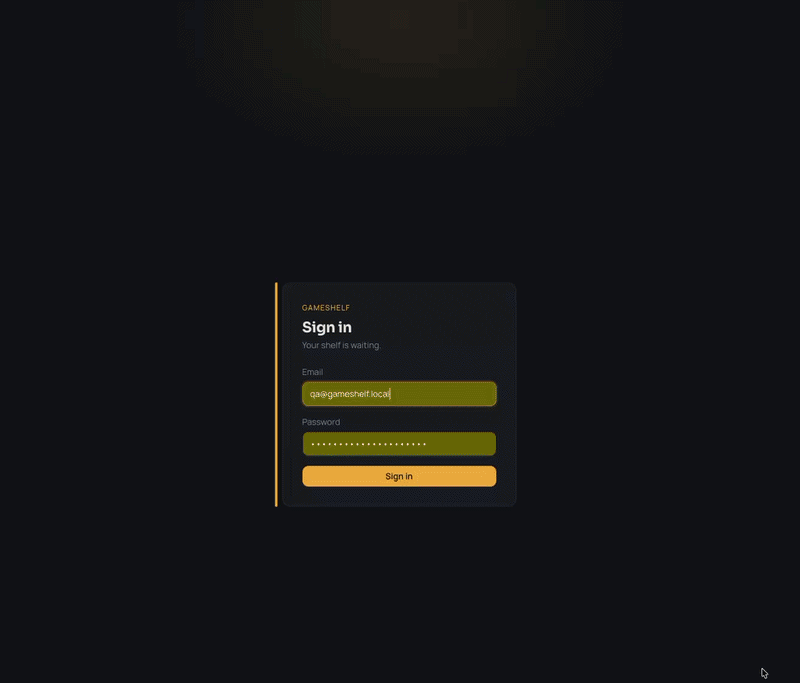

<div align="center">

# GameShelf

**Photograph your shelf. Get a catalog of your games.**

A self-hosted library for your physical video game collection. Upload a photo of
a shelf, let a vision LLM read the spines, and GameShelf adds every game it can
confirm against IGDB — with cover, platform, release year, publisher and genre.

<a href="LICENSE"></a>


</div>

<!-- TODO(demo-gif): record .github/assets/photo-import.gif (see .github/assets/README.md), then remove the comment markers around the block below. -->
<!--
<p align="center">
  
</p>
-->

## How it works

1. **Upload.** Drag, paste or browse up to 50 shelf photos at once (20 MB each;
   HEIC photos are converted in the browser). Each photo becomes a job in a
   MySQL-backed queue, so nothing is lost when the server restarts.
2. **Recognize.** A worker sends each photo once to your vision model, which
   returns the list of titles it can read.
3. **Confirm.** Every title is looked up in IGDB, with MobyGames as an optional
   fallback. Only confirmed titles become games, so a title the model invents
   never reaches your library.
4. **Enrich.** Confirmed games get platform, release year, publisher, genre,
   player count and a cover, downloaded once and served from your own server.
5. **Review.** Titles nobody could confirm are flagged on the import page, where
   you search for the right match, add the game by hand, or dismiss it.

Any OpenAI-compatible endpoint works, as long as its model accepts images: a
local model through Ollama, LM Studio or vLLM, or a hosted one through
OpenRouter or LiteLLM.

## Features

- **Photo import** with per-photo live progress, automatic retries, and a queue
  that pauses itself when a credential is rejected and resumes once it is fixed.
- **Catalog**: a cover-art grid with search, multi-select platform filters,
  sorting and advanced filters (year, players, publisher, genre, edition), all
  kept in the URL.
- **Game pages**: high-resolution covers, a screenshot and artwork gallery,
  summary, rating and YouTube videos. Edit any field, then re-enrich from IGDB
  without losing your edits.
- **Manual add** with catalog search and duplicate detection; a second physical
  copy bumps the copy count instead of creating a duplicate.
- **Platforms**: the canonical IGDB platform list synced locally, plus rename
  with aliases, merge and hide.
- **English and Polish UI**, with a light, dark or system theme.
- **Private by design**: one user, no public sign-up, server-side sessions and
  a strict same-origin Content Security Policy. Pages load nothing from third
  parties except YouTube videos on game pages.
- **Plain MySQL**: your whole library is one database you can back up with
  `mysqldump`.

<!-- TODO(demo-gif): record .github/assets/catalog-tour.gif (see .github/assets/README.md), then remove the comment markers around the block below. -->
<!--
## See it in action

<p align="center">
  
</p>
-->

## Quick start

You need **Node.js 24** and **Docker**. `npm run setup` starts the bundled MySQL
8.4 in Docker; to use your own MySQL 8.4 server instead, follow the manual setup
in the installation guide. [nvm](https://github.com/nvm-sh/nvm) is optional.

```bash
git clone https://github.com/5zymon/gameshelf.git
cd gameshelf
nvm install && nvm use   # Node 24, from .nvmrc
npm run setup            # install, create .env, start MySQL, apply migrations
npm run dev              # web on :3000, API on :3001
```

Open <http://localhost:3000>. On first run GameShelf sends you to `/setup` to
create your account; there is no public sign-up page.

Just looking around? Skip `/setup` and run `npm run db:seed` (development only).
It creates the login `qa@gameshelf.local` / `gameshelf-qa-password` and a few
sample games. Seeding creates a user, so `/setup` is closed afterwards.

To set up by hand, change ports, or open the app from your phone, see
[Installation & first run](docs/features/references/installation.md).

### Turn on photo import

The catalog works without any external service. Photo import needs two:

1. **A vision model.** In **Settings**, enter the base URL, model and API key of
   an OpenAI-compatible endpoint with a vision-capable model, save, and run the
   connection test. Local servers accept any non-empty key.
2. **IGDB credentials.** Create an application in the
   [Twitch developer console](https://dev.twitch.tv/console/apps) (no scopes),
   put its `IGDB_CLIENT_ID` and `IGDB_CLIENT_SECRET` in `.env`, restart
   `npm run dev`, and run `npm run platforms:sync` once to load the platform
   list.

MobyGames is an optional fallback (`MOBYGAMES_API_KEY`). Access is granted by
application, so leave it unset until you have a key. Details are in
[Configuration](docs/features/references/configuration.md).

## Documentation

| Guide                                                                | What's inside                                                            |
| -------------------------------------------------------------------- | ------------------------------------------------------------------------ |
| [Installation & first run](docs/features/references/installation.md) | Prerequisites, one-command and manual setup, ports, LAN access, accounts |
| [Configuration](docs/features/references/configuration.md)           | LLM, IGDB and MobyGames credentials; every environment variable          |
| [Operations](docs/features/references/operations.md)                 | MySQL, migrations, backup and restore, health checks                     |
| [Development](docs/features/references/development.md)               | Scripts, Task shortcuts, tests, CI, repository layout                    |
| [Operator runbook](docs/features/references/runbook.md)              | Which guide to open for each situation                                   |
| [Feature docs](docs/features/index.md)                               | One document per feature, plus architecture decisions (ADRs)             |

## Scope

GameShelf is built for **one person's library on one machine**: a single-user
app you run at `http://localhost` or on your home network. There is no
production deployment story (no reverse proxy, TLS terminator or multi-instance
setup), and Docker is a convenience for the database, not a requirement.

## Tech stack

| Package                | Path                 | What it is                                    |
| ---------------------- | -------------------- | --------------------------------------------- |
| `@gameshelf/web`       | `apps/web`           | Next.js frontend (Tailwind CSS v4, next-intl) |
| `@gameshelf/api`       | `apps/api`           | NestJS API with Prisma on MySQL 8.4           |
| `@gameshelf/contracts` | `packages/contracts` | Shared TypeScript wire types                  |

TypeScript throughout, in one npm-workspaces monorepo.

## Contributing

Issues and pull requests are welcome. Before opening a PR, run `task check`
(format, lint, typecheck) and `npm run test`. The
[Development guide](docs/features/references/development.md) covers the test
database, the CI gates and the git hooks.

## License

[MIT](LICENSE) © 2026 Szymon Nowak.

Game metadata and covers come from [IGDB](https://www.igdb.com/) and, optionally,
[MobyGames](https://www.mobygames.com/). Agent skills vendored under
`.opencode/skills/` keep their upstream licenses (see
`.opencode/skills/manifest.json`).
